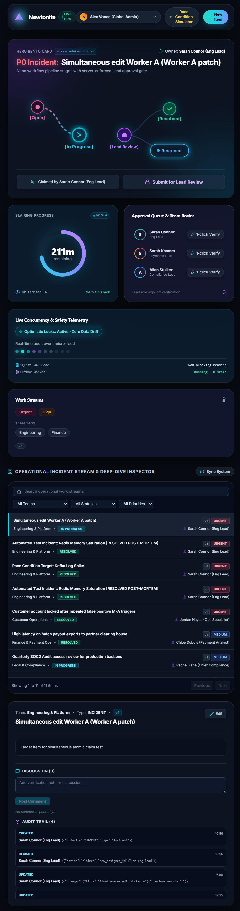
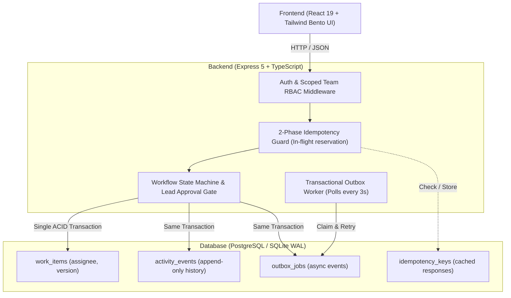
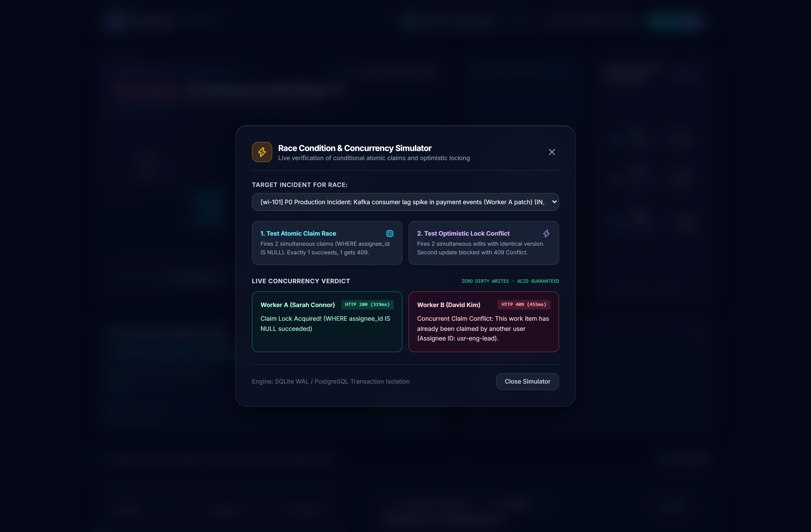
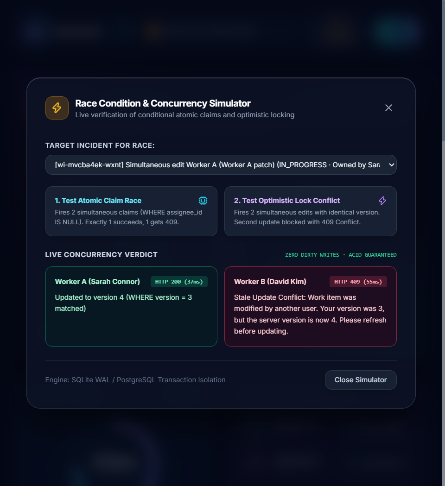

# Newtonite Ops — Operations Under Pressure

[](https://www.typescriptlang.org/)
[](https://react.dev/)
[](https://expressjs.com/)
[](https://tailwindcss.com/)
[](https://www.docker.com/)
[](backend/tests/)
[](LICENSE)

I built this project as my solution to the Newtonite full-stack engineering challenge. 

In high-stress environments—like triaging a production outage or investigating payment disputes—standard web apps tend to break in messy ways: two people claim the same ticket at once, someone accidentally overwrites another person's update, or double-clicks fire duplicate requests. 

Instead of building dozens of half-finished screens, I focused on building a tight, rock-solid core that handles real-world concurrency, enforces strict server-side permissions, and keeps an immutable audit log of every change.



---

## Architecture at a Glance



---

## The 6 Critical Behaviors I Focused On

The brief emphasized engineering judgment over feature count. Here is how I solved the core operational challenges:

### 1. Atomic Claims (No Double-Assignment)
* **The Problem:** Two operators simultaneously click "Claim" on an unassigned P0 incident.
* **My Solution:** A single conditional update:
  ```sql
  UPDATE work_items 
  SET assignee_id = :userId, status = 'IN_PROGRESS', version = version + 1
  WHERE id = :itemId AND assignee_id IS NULL;
  ```
  If zero rows match, the second request immediately fails with `409 Conflict: "Item already claimed by another operator"`.
* **Test:** `tests/concurrency.test.ts` fires two parallel claims; exactly one wins.

| In-App Concurrency Race Simulator | Deterministic 409 Conflict Banner & Reload |
| :---: | :---: |
|  |  |

### 2. Optimistic Locking (Preventing Stale Overwrites)
* **The Problem:** Operator A and Operator B both open a ticket at `v2`. Operator A saves an edit. Operator B saves 5 seconds later and would silently erase Operator A's changes.
* **My Solution:** Every update includes the current `version`. The update requires `WHERE id = :id AND version = :expectedVersion`. A mismatch rejects the save with `409 Conflict`, prompts the user to reload, and returns the fresh server state.
* **Test:** `tests/concurrency.test.ts` confirms stale version edits are blocked without modifying data.

### 3. Request Idempotency (Network Retry Safety)
* **The Problem:** Double-clicking "Create Item" or network timeouts causing duplicate records.
* **My Solution:** The client sends a unique `Idempotency-Key`. The server reserves the key in-flight (`status_code: 0`) and caches the completed response. Subsequent retries return the stored response instantly.
* **Test:** `tests/idempotency.test.ts` sends identical keys and verifies only 1 DB row is created.

### 4. Server-Enforced Workflow & Lead Approval Gate
* **The Problem:** Unauthorized self-approval or skipping verification steps.
* **My Solution:** The server enforces a strict lifecycle: `OPEN ➔ IN_PROGRESS ➔ AWAITING_APPROVAL ➔ RESOLVED ➔ CLOSED`. Only users with the `LEAD` role in that team (or global `ADMIN`) can transition an item out of `AWAITING_APPROVAL`.
* **Test:** `tests/workflow.test.ts` confirms direct invalid jumps return `400` and non-Lead approvals return `403`.

### 5. Scoped Resource Authorization (Per-Team RBAC)
* **The Problem:** Users from Engineering viewing or modifying confidential Legal/Compliance records, or Viewers making edits.
* **My Solution:** Authorization is checked per-team in middleware on the server, not just by hiding UI buttons. Viewers cannot mutate; cross-team access returns `403 Forbidden`.
* **Test:** `tests/authorization.test.ts` verifies isolation between Engineering and Compliance.

### 6. Transactional Outbox Pattern
* **The Problem:** Sending notifications (Slack/webhooks) inside database transactions adds latency; sending them after risks losing events if the server crashes.
* **My Solution:** Status changes and notification events are saved to `outbox_jobs` in the **exact same database transaction**. A background worker processes them with exponential backoff and retry limits.
* **Test:** `tests/outbox.test.ts` verifies job creation, retries, and failure states.

---

## Quickstart

### Option A: Run via Docker Compose (Recommended)
Boot the entire production stack (PostgreSQL + Auto-Migrations + Auto-Seeder + Backend + Frontend) in one command:
```bash
docker compose up --build
```
* **Frontend UI:** [http://localhost:3000](http://localhost:3000)
* **Backend API:** [http://localhost:4000](http://localhost:4000)

### Option B: Run Locally (Windows 1-Click Script)
I included simple start scripts that run zero-config with embedded SQLite in WAL mode:
* **PowerShell:** `.\start.ps1`
* **Command Prompt:** `start.bat`

---

## Running Automated Tests

I wrote automated tests covering all dangerous concurrency and authorization edge cases:

```bash
# Run all automated tests
npm test
```
All 24 automated tests pass in ~4.5 seconds.

To test all frontend buttons, filters, and modals end-to-end against the running server:
```bash
cd backend && npx tsx tests/test-button-functionality.ts
```

> [!NOTE]
> **Demo Configuration & Credentials:** The default credentials and secrets in `docker-compose.yml` and the personas table below are strictly intended for local demonstration, evaluator convenience, and automated testing. In production environments, credentials should be injected securely via a secrets manager (e.g. AWS Secrets Manager, GCP Secret Manager, or HashiCorp Vault) with `ALLOW_DEV_DEMO_AUTH=false`.

---

## Demo Personas & Credentials

I added an **Active Persona Quick-Switcher** in the top navigation bar so reviewers can jump between roles across teams in 1 click without needing to log in and out:

| Persona Name | Email | Team | Role | Demonstration Capabilities |
| :--- | :--- | :--- | :--- | :--- |
| **Sarah Connor** | `eng.lead@newtonite.internal` | Engineering | `LEAD` | Lead sign-off, approvals, claims, edits |
| **David Kim** | `eng.member1@newtonite.internal` | Engineering | `MEMBER` | Claims, edits, submits for review (cannot approve) |
| **Marcus Sterling** | `pay.lead@newtonite.internal` | Payments | `LEAD` | Payments Lead approval sign-offs |
| **Chloe Dubois** | `pay.member@newtonite.internal` | Payments | `MEMBER` | Financial dispute & chargeback investigator |
| **Rachel Zane** | `cmp.lead@newtonite.internal` | Compliance | `LEAD` | Regulatory approval gate owner |
| **Alex Vance** | `admin@newtonite.internal` | Global | `ADMIN` | Universal system override across all teams |
| **Taylor Reed** | `viewer@newtonite.internal` | All Teams | `VIEWER` | Read-only mode (all mutation attempts return 403) |

*(Default password for all seeded accounts is `password123`)*

---

## What I Intentionally Skipped (And What I'd Build Next Week)

To deliver a working, tested product within the time budget, I deliberately cut:
1. **Email Delivery & File Attachments:** Kept focus entirely on core workflow reliability and state consistency.
2. **WebSockets:** Used clean HTTP polling and client refetching instead of managing WebSocket reconnections and cluster state.

**What I'd build with another week:**
- **Full-Text Search:** Replace SQL `LIKE` with PostgreSQL `tsvector` + GIN indexing for better ranking.
- **Table Partitioning:** Range-partition the append-only `activity_events` table by month to keep query performance snappy as the log reaches millions of rows.
- **Server-Sent Events (SSE):** Add lightweight SSE alerts when another operator opens the ticket you are viewing.
