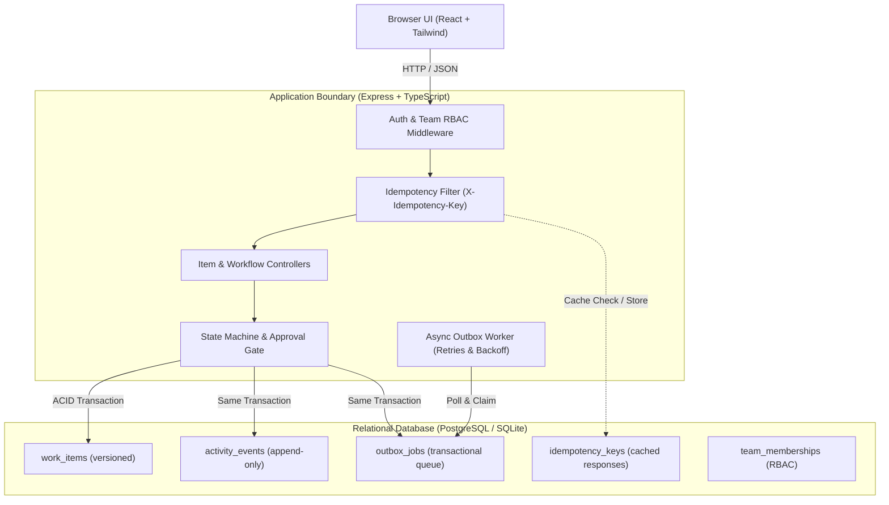

# Newtonite Operations Platform ("Operations Under Pressure")

An internal operational coordination platform designed for high-concurrency environments across distributed teams. It replaces chaotic email/Slack triage with server-enforced workflow state machines, atomic concurrent claims, optimistic locking, idempotent request processing, and an immutable transactional audit trail.

---

## Architecture Diagram



---

## Critical Behaviors Beyond CRUD

This platform solves real-world distributed consistency challenges with automated tests:

1. **Atomic Concurrent Claims (Race Condition Defense):**
   * *Problem:* Two users attempt to claim an unassigned urgent item at the same second.
   * *Solution:* Conditional update (`UPDATE ... WHERE assignee_id IS NULL`). If 0 rows updated, returns `409 Conflict`.
   * *Verification:* `tests/concurrency.test.ts` fires two parallel claims; exactly one succeeds.

2. **Optimistic Locking (Stale Edit Protection):**
   * *Problem:* A user edits an item based on outdated information.
   * *Solution:* Mutations supply the item's `version`. The update requires `WHERE version = :expectedVersion`. Mismatches throw `409 Conflict` and return the latest state.
   * *Verification:* `tests/concurrency.test.ts` verifies stale version updates are rejected without data loss.

3. **Request Idempotency (Network Retry Safety):**
   * *Problem:* Network disconnects or double-clicks causing duplicate ticket creations.
   * *Solution:* Client sends `Idempotency-Key`. Server caches responses in `idempotency_keys` table and replays the cached payload on retries.
   * *Verification:* `tests/idempotency.test.ts` sends identical keys twice; verifies only 1 DB row is created.

4. **Workflow State Machine & Lead Approval Gate:**
   * *Problem:* Bypassing operational procedures or unverified self-approval.
   * *Solution:* Server enforces strict state transitions (`OPEN` $\rightarrow$ `IN_PROGRESS` $\rightarrow$ `AWAITING_APPROVAL` $\rightarrow$ `RESOLVED` $\rightarrow$ `CLOSED`). Transitioning out of `AWAITING_APPROVAL` is strictly restricted to Team Leads and Admins.
   * *Verification:* `tests/workflow.test.ts` asserts illegal jumps return `400` and non-Lead approval attempts return `403`.

5. **Resource-Level Team Isolation:**
   * *Problem:* Unauthorized cross-team access or viewer privilege escalation.
   * *Solution:* Server evaluates user memberships per team. Cross-team users and Viewers attempting mutations receive `403 Forbidden`.
   * *Verification:* `tests/authorization.test.ts` verifies isolation between Engineering and Compliance items.

6. **Transactional Outbox Background Processing:**
   * *Problem:* Notifications lost on server crashes or dual-write failures.
   * *Solution:* Outbox jobs are recorded in the exact same DB transaction as item updates. A background worker processes jobs with exponential backoff and retry caps.
   * *Verification:* `tests/outbox.test.ts` tests outbox event generation, retries, and failure states.

---

## Prerequisites

* **Node.js** v20+ (tested on v22)
* **npm** v10+
* *(Optional for Containerization)* **Docker** & **Docker Compose**

---

## Quickstart

### Option A: Run via Docker Compose (Recommended for Reviewers)

To boot the entire production stack (PostgreSQL + Auto-Migrations + Auto-Seeder + Backend + Frontend) in one command:

```bash
docker compose up --build
```

* **Frontend UI:** [http://localhost:3000](http://localhost:3000)
* **Backend API:** [http://localhost:4000](http://localhost:4000)
* **Health Check:** [http://localhost:4000/health](http://localhost:4000/health)

---

### Option B: Run Locally without Docker (Zero-Config Development)

The platform includes embedded SQLite fallback, allowing instantaneous execution without needing external databases installed:

1. **Install Dependencies:**
   ```bash
   cd backend && npm install
   cd ../frontend && npm install
   cd ..
   ```

2. **Seed Database:**
   ```bash
   npm run seed
   ```

3. **Start Development Servers:**
   ```bash
   # Terminal 1: Backend
   npm run dev:backend

   # Terminal 2: Frontend
   npm run dev:frontend
   ```
   Open [http://localhost:3000](http://localhost:3000) in your browser.

---

## Running Automated Tests

To run the complete automated test suite covering all concurrency, idempotency, workflow, and authorization scenarios:

```bash
npm test
```

All 11 test cases across 5 test suites run and pass in ~2 seconds.

---

## Demo Personas & Credentials

The application includes an **Active Persona Quick-Switcher** in the top-right header so reviewers can switch roles across teams with 1 click without logging in and out.

| Persona Name | Email | Team | Role | Demonstration Capabilities |
| :--- | :--- | :--- | :--- | :--- |
| **Sarah Connor** | `eng.lead@newtonite.internal` | Engineering | `LEAD` | Can approve, reassign, claim, edit, transition |
| **David Kim** | `eng.member1@newtonite.internal` | Engineering | `MEMBER` | Can claim items, edit, submit for review (cannot approve) |
| **Marcus Sterling** | `pay.lead@newtonite.internal` | Payments | `LEAD` | Payments Team Lead (Lead approval rights) |
| **Chloe Dubois** | `pay.member@newtonite.internal` | Payments | `MEMBER` | Financial disputes & chargeback investigator |
| **Rachel Zane** | `cmp.lead@newtonite.internal` | Compliance | `LEAD` | GDPR / Regulatory Lead (Approval gate owner) |
| **Alex Vance** | `admin@newtonite.internal` | Global | `ADMIN` | Global superuser access across all teams |
| **Taylor Reed** | `viewer@newtonite.internal` | All Teams | `VIEWER` | Read-only access (mutations return 403 Forbidden) |

*(Password for all seeded accounts is `password123`)*

---

## Known Limitations & Future Improvements (Next Week Roadmap)

1. **Full-Text Search Engine:** Current search uses indexed SQL `LIKE` queries. At $10\times$ scale (millions of items), migrating to PostgreSQL `tsvector` with GIN indexing or Elasticsearch would enhance ranking.
2. **Real-time Server-Sent Events (SSE):** The current frontend uses manual refetching and error-triggered reload. Adding SSE or lightweight WebSockets for live cursor alerts when another user opens the same item would further reduce collision rates.
3. **Partitioning Activity Events:** Because the append-only `activity_events` table grows continually, range-partitioning by `created_at` (e.g., monthly partitions) will ensure optimal read performance.
